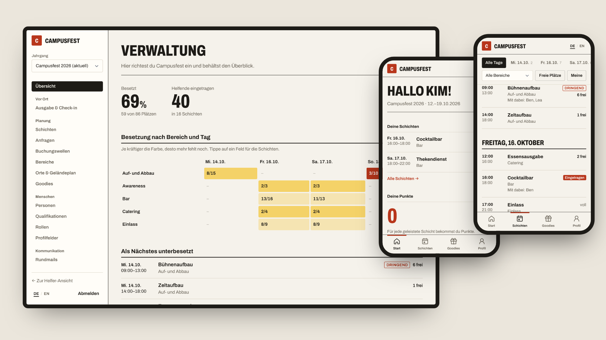

# Wichtel

**Das Helfer- und Schichtsystem für ehrenamtliche Festivals** – Helfende tragen sich auf dem Handy
in Schichten ein, sammeln Punkte für Goodies, und die Orga behält den Überblick.

_A volunteer and shift management system for non-profit festivals (German/English)._

<picture>
  <source media="(prefers-color-scheme: dark)" srcset="docs/src/assets/images/overview-dark.png">
  
</picture>

## Was du bekommst

**Für Helfende** – ohne Anleitung benutzbar, gemacht fürs Handy

- Schichten nach Tagen durchsehen und mit einem Tipp eintragen; Überschneidungen werden verhindert
- Schichten abgeben oder tauschen, Warteliste, gemeinsam mit Freund\*innen eintragen
- Punkte sammeln und gegen Goodies tauschen – das Freiticket kommt automatisch zuerst
- Treffpunkte auf Geländeplan und Karte, Erinnerungen per E-Mail, Kalender-Abo

**Für Leitungen**

- Übersicht, wo noch Leute fehlen, mit Heatmap nach Bereich und Tag
- Schichten und ganze Serien in Minuten anlegen, Druckansichten für vor Ort
- Anfragen und Übergaben freigeben, Dringend-Aufruf per E-Mail, Check-in per QR-Code

**Für die Organisation**

- Bereiche, Rollen und Rechte frei konfigurierbar, vererbt im Bereichsbaum
- Buchungswellen, Punkte-Regeln, Goodies, Profilfelder, Farben und Logo – alles in der Oberfläche
- Jahrgang kopieren, Protokoll aller Änderungen, Deutsch und Englisch, Hell- und Dunkelmodus
- Optional: Planen mit KI-Assistenten wie Claude, immer mit den Rechten der jeweiligen Person

Die vollständige Liste steht in der [Hilfe unter „Funktionen“](https://yniverz.github.io/wichtel/reference/features/).

## Schnellstart

```bash
curl -O https://raw.githubusercontent.com/yniverz/wichtel/main/docker-compose.yml
curl -o .env https://raw.githubusercontent.com/yniverz/wichtel/main/.env.example
# in .env PUBLIC_URL und POSTGRES_PASSWORD setzen
docker compose up -d && docker compose logs app   # zeigt den Einrichtungslink
```

Portainer, Reverse Proxy, E-Mail und Sicherung: [Hilfe für den Betrieb](https://yniverz.github.io/wichtel/operators/).

## Hilfe und Dokumentation

**[yniverz.github.io/wichtel](https://yniverz.github.io/wichtel/)** – auf Deutsch und
[Englisch](https://yniverz.github.io/wichtel/en/), mit Suche. Jede Seite der App verlinkt direkt
auf die passende Hilfeseite.

| Für                                                           | Inhalt                                                     |
| ------------------------------------------------------------- | ---------------------------------------------------------- |
| [Helfende](https://yniverz.github.io/wichtel/helpers/)        | Schichten eintragen und tauschen, Punkte, Goodies, Konto   |
| [Leitungen](https://yniverz.github.io/wichtel/leads/)         | Schichten planen, Besetzung, Anfragen, Check-in vor Ort    |
| [Organisation](https://yniverz.github.io/wichtel/organizers/) | Jahrgänge, Bereiche, Rollen, Wellen, Punkte, Einstellungen |
| [Betrieb](https://yniverz.github.io/wichtel/operators/)       | Installation, Konfiguration, Updates, Backups              |
| [Nachschlagen](https://yniverz.github.io/wichtel/reference/)  | Glossar, Funktionen, Rechte, Entwicklung, Konzept, Design  |

Die Quelle der Hilfe liegt in [`docs/`](docs/README.md).

## Status

Alle geplanten Funktionen sind umgesetzt, einschließlich Datenauskunft, Kontolöschung,
Löschfristen und einer Vorlage für die Datenschutzerklärung. Vor dem ersten echten Einsatz fehlt
noch ein Testlauf unter Last.

## Lizenz

[GNU Affero General Public License v3.0](LICENSE) © The Wichtel contributors
