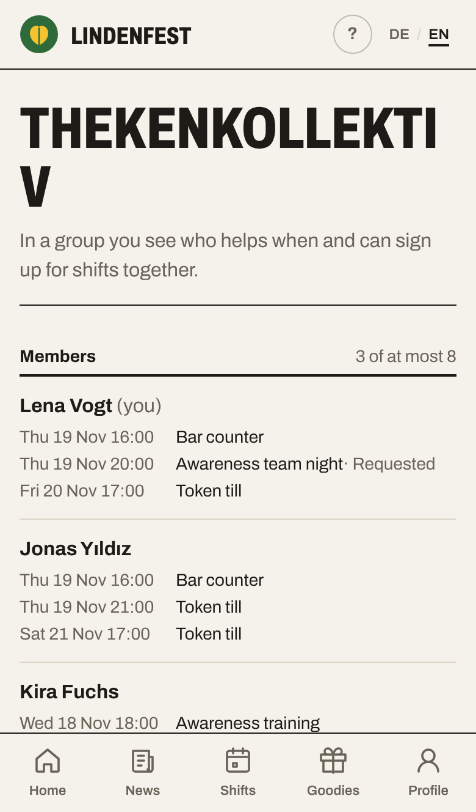

:::tip[At a glance]

- **Start:** _Profile_ → _Group_ → _Group name_ → _Start group_.
- **Invite:** _Copy link_ and send it to the others. They open it and tap _Join_.
- **Sign up together:** tap a shift → _Sign up with group_ → tick people → _Sign up and reserve
  places_.
- The others have to **accept** their reserved place, otherwise it lapses.

:::

## Start a group

1. Tap _Profile_ → _Group_ (or on the home page under _Your group_ tap _Start a group_).
2. Under _New group_ enter a _Group name_, for example "Flat Main Street".
3. Tap _Start group_. You see _Group started. Now invite the others._

## Invite others and join

**Invite:** Under _Invite_, tap _Copy link_ and send the link, for example via a messenger. The code
is shown there too, in case someone prefers to type it.

**Join:**

1. Open the link. If you are not logged in, log in first.
2. The _Invite code_ is already filled in. Tap _Join_.
3. You see _Welcome to the group._

Without the link: _Profile_ → _Group_ → under _Join a group_ enter the _Invite code_ → _Join_.

A group has a maximum size (usually 8 people); under _Members_ it says for example _3 of at most
8_. You can be in **one** group per festival year.

## See who helps when

- Under _Profile_ → _Group_ you see all _Members_ with their upcoming shifts – including requests
  and reserved places.
- In the shift list, _Also there: …_ appears below a shift if someone from your group is on it.

## Sign up together

1. Tap the shift. For positions with booking mode _direct_ and at least two free places, the link
   _Sign up with group_ appears below _Sign up_.
2. Under _Who comes along?_ tick the people. You can only tick as many as there are places free.
3. Tap _Sign up and reserve places_.

Then the following happens:

- **You** are signed up right away.
- **For the others** a place is reserved. They get an email "Place reserved for you", and they see
  _Reserved for you_.
- They accept the place on the home page under _Waiting for you_ or in the shift with _Accept_ – or
  release it with _Decline_.
- The reservation holds for a certain time (usually 24 hours, at most until the shift starts).
  _Reserved until …_ shows until when. After that it lapses, the place becomes free again, and the
  person gets the email "Reservation expired".

If it does not work for someone, you see _This does not work for everyone:_ with the names and the
reason. In that case **nobody** is signed up – untick the people named and try again.

## Leave the group

_Profile_ → _Group_ → _Leave group_. Your shifts stay as they are. When the last person leaves, the
group is dissolved.

## Common questions

### The invite link got into the wrong hands.

Tap _Create new link_. The old link stops working. Anyone already in the group stays in it.

### Can we also book positions "on request" together?

No. Each person requests such positions individually.

### I don't see groups.

If it says _Groups are currently not enabled._, your festival does not use this feature.

## Special cases

Why a reserved place blocks other shifts

A reserved place counts like a booking: it takes up a place on the shift, and you cannot sign up
elsewhere at the same time. Release it with _Decline_ if you cannot make it – then someone from the
waiting list may move up.

What is checked when signing up together

For each person the same applies as when signing up alone: they must be able to see the shift and
be allowed to book right now, must not already be on the shift, need the required qualifications
and must not have another shift at the same time.

## See also

- [Find shifts and sign up](/wichtel/en/helpers/shifts/)
- [I cannot sign up](/wichtel/en/helpers/cannot-book/)
