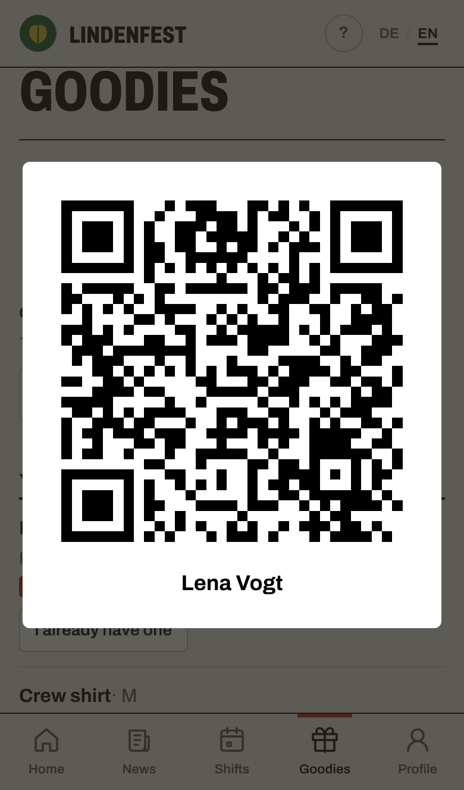

:::tip[At a glance]

- **Your code:** _Goodies_ → _Your code_ (tap to enlarge). Show it at the volunteer desk and the
  goodie counter.
- **Find the meeting point:** tap the shift → tap the place name with the pin icon.
- There you get the site plan, a map and links to Google Maps or Apple Maps.

:::

## Your personal QR code

Under _Goodies_ you see _Your code_ with your name. Tap the code to show it larger. On a phone there
is also the button _Show my code_ at the top.

Show the code:

- **at the volunteer desk** – you are checked in for today's shifts there. That is how you get your
  [points](/wichtel/en/helpers/points-goodies/).
- **at the goodie counter** – you get the goodies you have chosen there.

The team there scans the code with a phone and sees your shifts and goodies. For anyone else the
code is useless: without permission they only see _This code is unknown._

:::tip
Take a screenshot of the code beforehand – then it works even if the mobile network on site is
weak.
:::

## Finding places

Where Wichtel knows a place, its name is underlined with a pin icon:

- in the shift details next to _Location_ and _Meeting point_,
- for goodies under _Pickup_,
- on the home page under _How to find the volunteer desk_.

Tapping it opens a window with:

- the place's **name, address and description**,
- your festival's **site plan** with a marker showing where the place is,
- a **map**: tap _Load map_. Only then is the map loaded from a map service; your IP address is sent
  to that service. Nothing is loaded unless you tap.
- **_Open in:_ Google Maps, Apple Maps, OpenStreetMap** – to navigate in your
  favourite app.

What appears depends on what the organisers have entered for the place. If _Location_ or _Meeting
point_ only shows text without an icon, that description is all there is.

The emails about your shifts also include the location and meeting point, usually with a link to
Google Maps.

## Common questions

### I cannot find the meeting point.

Look for the _Contact_ in the shift details and get in touch, or go to the volunteer desk.

### Where and when is the volunteer desk open?

The home page shows the place under _How to find the volunteer desk_, if the organisers have set
it. You find opening times in _News_ or get them from the organisers.

## See also

- [Points and goodies](/wichtel/en/helpers/points-goodies/)
- [News](/wichtel/en/helpers/news/)
