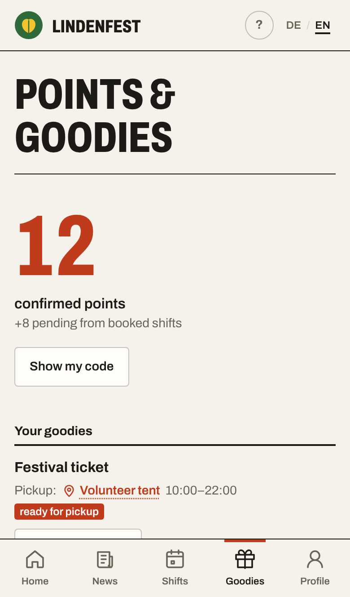
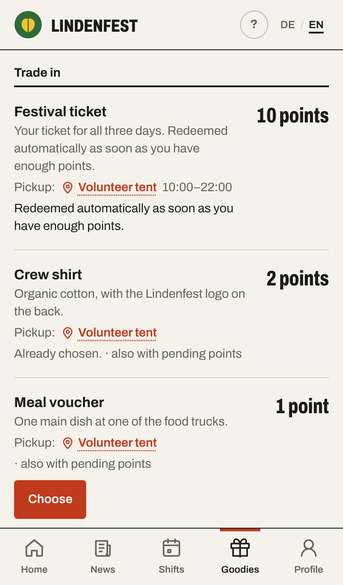

:::tip[At a glance]

- You get **points** for every shift where it is confirmed that you were there.
- Until then they show as _pending from booked shifts_.
- **Get a goodie:** _Goodies_ → _Choose_ → pick it up at the counter and show your code.
- **Mandatory goodies** such as the free ticket come first, automatically.

:::

## Points

### When do I get points?

How many points a shift earns is shown at each position (for example _· 3 points_). They are
**credited** as soon as your attendance is confirmed – usually at check-in at the volunteer desk
(with your [QR code](/wichtel/en/helpers/on-site/)) or by the shift lead. This is possible from the
day of the shift.

At the top of _Goodies_ you see:

- **_confirmed points_:** points from shifts where you are marked as present – minus the points for
  goodies you have already chosen.
- **_+… pending from booked shifts_:** points you will get for your booked shifts as soon as your
  attendance is confirmed.

The home page also shows your total under _Your points_.

### How many points are there?

Your festival decides: per shift, per hour or both, and possibly different for individual areas or
positions. There may also be bonuses:

- a **night bonus** for shifts during the night,
- a **last-minute bonus** if you sign up shortly before the start or move up from the waiting
  list shortly before,
- **bonus points for urgent calls:** If a shift shows _Urgent_ and _+… bonus points_, you get them
  on top if you sign up while the call is running.

The shift list shows points without the last-minute bonus; it is added when the points are
credited.

### Points history

_Goodies_ → _Points history_ lists every entry: points for shifts, deductions for goodies and
_Correction_ with a reason when a lead adjusted something by hand.

## Choosing goodies

1. Tap _Goodies_. Under _Trade in_ you see all goodies with their price in points (or _free_).
2. If a goodie comes in several versions (for example sizes), pick the right one under _Option_.
3. If the goodie asks for details (_For this we still need:_), fill them in.
4. Tap _Choose_. You see _Chosen – pick it up at the counter._ The points are deducted right away.
5. Under _Your goodies_ it now shows _ready for pickup_ and the pickup place.

**Pick-up:** Go to the place shown (_Pickup: …_, otherwise the volunteer desk) and show your code
(_Goodies_ → _Your code_). Afterwards the goodie shows _picked up_.

### Why can't I choose a goodie?

| Shown                                  | Meaning                                                                                    |
| -------------------------------------- | ------------------------------------------------------------------------------------------ |
| _You need 5 points more._              | You do not have enough points yet.                                                         |
| _also with pending points_             | You can already choose this goodie with pending points.                                    |
| _Only for volunteers of: …_            | Only people with a confirmed shift in one of these areas can choose it.                    |
| _Already chosen._                      | There are no more of these per person.                                                     |
| _Currently gone – ask at the counter._ | None are left to choose yourself. The counter may sometimes still be able to hand one out. |
| _3 left_                               | This many can still be chosen.                                                             |

## Mandatory goodies (e.g. free ticket)

Some goodies are listed with _Redeemed automatically as soon as you have enough points._ This is
usually the free ticket or something similar.

- You do not choose them yourself. As soon as your confirmed points are enough, the goodie is
  redeemed for you automatically and appears under _Your goodies_. This also happens when a lead
  credits you points by hand.
- If it has options (for example sizes), the first one is chosen to begin with. Until pickup you can
  pick another one under _Your goodies_ and tap _Change option_.
- If there are several, they are redeemed in the order your festival has set.
- **The first points go to mandatory goodies.** As long as one is still open, you can only use the
  points beyond that for other goodies.

## Undo a choice or get a refund

As long as a goodie is still _ready for pickup_:

- **_Change option_:** For goodies with options, pick another one, for example a different size.
  This also works for mandatory goodies.
- **_Undo_:** You get the points back. Not possible for mandatory goodies.
- **_I already have one_:** Shown for goodies that can be refunded – for example if you have already
  bought a ticket. The goodie is then refunded instead of handed out; the points stay used. It then
  shows _refund pending_ and, once refunded, _refunded_. The organisers tell you how and where the
  refund happens.

## Common questions

### I was at the shift but did not get any points.

Then your attendance has not been recorded yet. Talk to the shift lead or the volunteer desk – they
can catch up on it. If points are still missing, a lead can correct them by hand.

### Do my points carry over to next year?

No. Points and goodies apply to one festival year.

### When and where is the goodie counter?

The goodie shows it under _Pickup_. Opening times and everything else you find in _News_ or get
from the organisers.

## See also

- [On site: QR code and places](/wichtel/en/helpers/on-site/)
- [Find shifts and sign up](/wichtel/en/helpers/shifts/)
