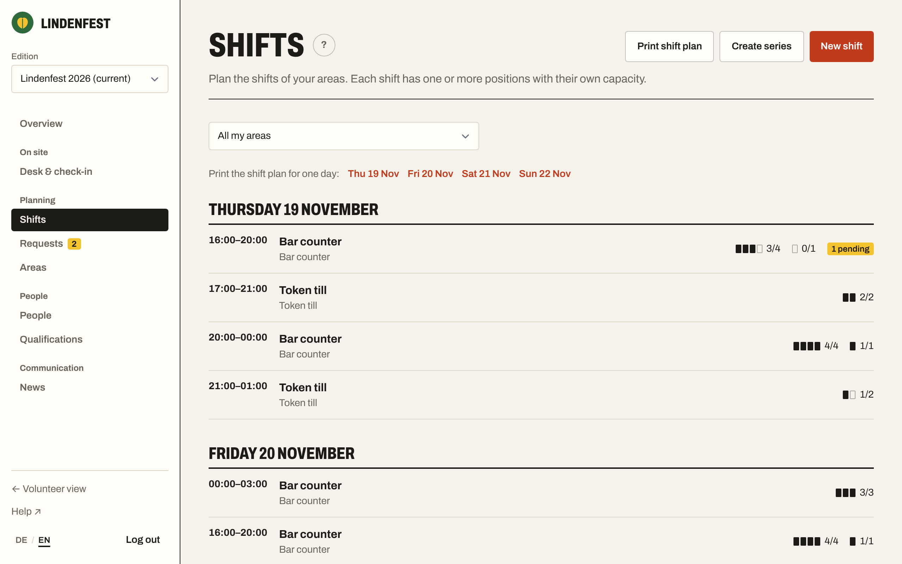

:::tip[At a glance]

- **New:** _Shifts_ → _New shift_ → fill in the fields → _Create_.
- **Change:** tap the shift in the list → below, _Edit shift_ → _Save_.
- **Same shift on another day:** open the shift → _Duplicate_.
- **Cancel:** open the shift → at the very bottom _Delete shift_. Everyone signed up gets an e-mail.
- Your role needs _Create and edit shifts_ in the shift's area.

:::

## Step by step: new shift

1. Open _Shifts_ and tap _New shift_. If you filtered the list to an area before, it is already
   selected.
2. Fill in the fields (see below). Only _Area_, _Title (German)_, _Date_, _Start_, _End_ and at least
   one position are required.
3. Tap _Create_. You land on the new shift's page and can sign people up straight away.

Many identical shifts are better created as a [series](/wichtel/en/leads/series/).

## The fields

**Shift**

- _Area_ – only areas in which you may create shifts (including their sub-areas).
- _Title (German)_ and _Title (English)_ – the English title is optional. Without it, volunteers using
  English also see the German one.

**Time**

- _Date_, _Start_, _End_ – in the festival's time zone. If the end is before the start, the shift ends
  the next day (e.g. 22:00–02:00).

**Positions** – one or more positions with their own capacity, booking mode, points and
qualifications. Everything about them is under [Positions](/wichtel/en/leads/positions/).

**Location**

- _Place (with pin)_ and _Meeting point (with pin)_ – only appear if places have been created for the
  edition. Volunteers then see the place on the site plan or the map.
- _Location_ and _Meeting point_ – free text that adds details, e.g. “behind the tent”.
- _Contact on site_ – e.g. name and phone number of the shift lead. Everyone who can see the shift
  sees this.
- _Description (German)_ and _Description (English)_ – what needs doing, what to bring.

**Booking**

- _Visible to_:
  - _all volunteers_ – the shift is public.
  - _only people with a role in this area_ – the shift is internal, e.g. for the core crew. It is
    marked “(internal)” in lists.
- _Cancellation deadline (hours)_ – up to how many hours before the start volunteers can remove
  themselves. Leave empty to use the area or instance default.

## Changing

1. Tap the shift in the _Shifts_ list.
2. Below the staffing you find _Edit shift_ with the same fields.
3. Change what is needed and tap _Save_.

If _Date_, _Start_, _End_, or the free-text _Location_ or _Meeting point_ change, everyone who is
signed up, has requested or holds a reserved place gets an e-mail “Changed: …” with the new details.
Other changes (title, description, positions, place with pin) send no e-mail – if you want to say
something about them, use _Message everyone_ (see [News](/wichtel/en/leads/news/)).

## Duplicating

1. Open the shift and tap _Duplicate_ at the top.
2. _New shift_ opens with all details and positions of the original, but without bookings.
3. Change the date and time (and anything else that should differ) and tap _Create_.

## Cancelling (deleting)

In Wichtel, cancelling a shift means deleting it.

1. Open the shift and scroll to the very bottom.
2. Tap _Delete shift_ and confirm.

:::caution
This cannot be undone. All bookings, requests, reservations and waiting-list places of the shift are
removed. Everyone affected gets the e-mail “Cancelled: …” saying that the shift will not take place,
with a link to the other shifts.
:::

Points that people have already been credited for this shift stay with them.

## Common questions

### Why can I see a shift but not edit it?

In this shift's area you only have permissions to sign people up or tick them off, not _Create and
edit shifts_. Then the _Edit shift_ section is missing, and _New shift_ and _Duplicate_ do not
appear.

### Can I move a shift to another area?

Yes, with the _Area_ field when editing – but only to areas in which you may also create shifts.

### Who sees an internal shift?

Everyone who has a role in the edition that covers this area: a role for exactly this area, for an
area above it, or for the whole edition. Admins always see it.

## Special cases

I cannot remove a position or reduce its places

Positions with bookings or requests cannot be removed, and the capacity cannot drop below the number
of bookings. Remove or move the people first (see [Staffing](/wichtel/en/leads/staffing/)).

What happens to the waiting list when I add places?

If there are free places and people on the waiting list, they move up automatically when you save
and get an e-mail. For positions _on request_ the waiting-list place becomes a request.

Is there a record of my changes?

Yes. Creating, changing and deleting shifts is recorded in the audit log, which people with the
permission _View audit log_ can read.

## See also

- [Creating a series](/wichtel/en/leads/series/)
- [Positions](/wichtel/en/leads/positions/)
- [Places & site plan (for admins)](/wichtel/en/organizers/places/)
- [Deadlines and booking rules](/wichtel/en/organizers/booking-rules/)
