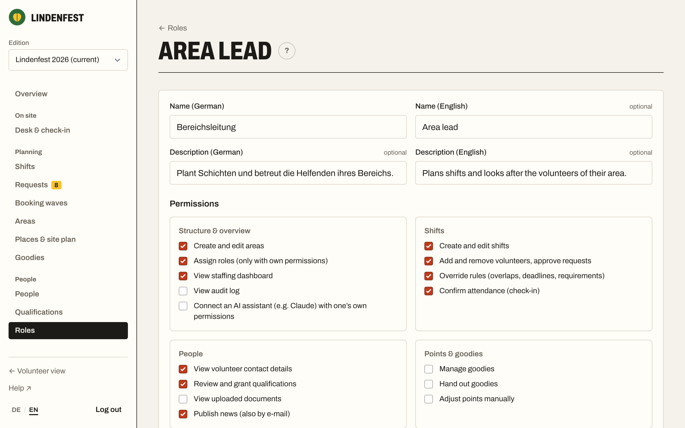

:::tip[At a glance]

- A **role** bundles permissions, e.g. _Area lead_. You create roles under _Roles_.
- **Assign:** _People_ → person → choose _Role_ and _Applies to_ → _Assign role_.
- Assigned **for an area**, the role applies there and in all sub-areas; _Whole edition_ applies
  everywhere.
- An assignment applies to **one edition only**.
- **Nobody can grant more permissions than they have.** Admins may do everything.

:::

## Step by step

### Creating or changing a role

1. Open _Roles_ and tap _New role_ – or an existing role.
2. Enter _Name (German)_ and _Name (English)_, ideally with a short description.
3. Under _Permissions_, tick what the role may do (explained below).
4. Tap _Create_ or _Save_.

Changes to a role take effect immediately for everyone who has it – in all editions. Only admins
create, change and delete roles.

### Assigning a role

1. In the _Edition_ switch at the top, choose the edition the role should apply to.
2. Open _People_, search for the person and open them. They need an account already.
3. Under _Roles in edition …_: choose the _Role_, and under _Applies to_ the area or _Whole edition_.
4. Tap _Assign role_.

To take it away, tap _Remove_ next to the role.

## All permissions

### Structure & overview

| Permission                                                         | What it allows                                                                                                                                                                                                                                     |
| ------------------------------------------------------------------ | -------------------------------------------------------------------------------------------------------------------------------------------------------------------------------------------------------------------------------------------------- |
| _Create and edit areas_                                            | Create sub-areas, edit, move and delete areas. Top-level areas only with the permission for the whole edition.                                                                                                                                     |
| _Assign roles (only with own permissions)_                         | Assign and remove roles under _People_ – only where one has this permission, and only roles whose permissions one holds there completely.                                                                                                          |
| _View staffing dashboard_                                          | See the staffing of one's own areas on the _Overview_ (figures, table by area and day, understaffed shifts) – read-only, without being able to open the shifts. Also opens the admin area. Anyone with shift permissions sees the staffing anyway. |
| _View audit log_                                                   | Read the [audit log](/wichtel/en/organizers/audit/) of the selected edition. Only works with _Whole edition_.                                                                                                                                      |
| _Connect an AI assistant (e.g. Claude) with one’s own permissions_ | Connect an [AI assistant](/wichtel/en/organizers/ai/). Only counts in the current edition.                                                                                                                                                         |

### Shifts

| Permission                                           | What it allows                                                                                                               |
| ---------------------------------------------------- | ---------------------------------------------------------------------------------------------------------------------------- |
| _Create and edit shifts_                             | Plan shifts and series. With _Whole edition_ also _Booking waves_ and _Places & site plan_.                                  |
| _Add and remove volunteers, approve requests_        | Add people to shifts and remove them, decide requests and handovers.                                                         |
| _Override rules (overlaps, deadlines, requirements)_ | _Add anyway_, even if the position is full, something overlaps, the shift has already started or a qualification is missing. |
| _Confirm attendance (check-in)_                      | Tick people off in the roster and check them in under _Desk & check-in_.                                                     |

### People

| Permission                        | What it allows                                                                                                                      |
| --------------------------------- | ----------------------------------------------------------------------------------------------------------------------------------- |
| _View volunteer contact details_  | See volunteers' phone numbers and e-mail addresses in one's own areas. Only counts in the current edition.                          |
| _Review and grant qualifications_ | Approve or reject proofs, grant and revoke qualifications. Qualifications apply to everyone – the permission in any area is enough. |
| _View uploaded documents_         | Open uploaded documents. Only counts in the current edition.                                                                        |
| _Publish news (also by e-mail)_   | Write news for one's own areas and their shifts; with _Whole edition_ also to wider groups.                                         |

### Points & goodies

| Permission               | What it allows                                                                                    |
| ------------------------ | ------------------------------------------------------------------------------------------------- |
| _Manage goodies_         | Create and change goodies. Only works with _Whole edition_.                                       |
| _Hand out goodies_       | Hand out goodies under _Desk & check-in_.                                                         |
| _Adjust points manually_ | Add or remove points under _Desk & check-in_ → _Correct points_. Only works with _Whole edition_. |

The lead pages explain how to work with these permissions: [I lead an area](/wichtel/en/leads/). An
overview of all permissions is also in [Permissions](/wichtel/en/reference/permissions/).

## Typical roles

During setup Wichtel creates these templates. You can change them freely. In installations set up
with an older version, _Festival lead_ still lacks _Connect an AI assistant_ – add it under _Roles_
if they should use AI assistants.

| Role             | Typically assigned for | Permissions                                                                                                                      |
| ---------------- | ---------------------- | -------------------------------------------------------------------------------------------------------------------------------- |
| _Festival lead_  | _Whole edition_        | all, including _Connect an AI assistant_                                                                                         |
| _Area lead_      | one area               | areas, assign roles, dashboard, shifts, add and remove, override rules, attendance, review qualifications, contact details, news |
| _Shift lead_     | one (sub-)area         | attendance, contact details, dashboard                                                                                           |
| _Volunteer desk_ | _Whole edition_        | dashboard, add and remove, attendance, review qualifications, contact details, hand out goodies                                  |
| _Goodie desk_    | _Whole edition_        | hand out goodies                                                                                                                 |

Examples:

- **Bar lead:** _Area lead_ for "Bar". They plan all shifts in "Bar" and its sub-areas and can assign
  _Shift lead_ there themselves.
- **Info desk at the entrance:** _Volunteer desk_ for the _Whole edition_, so every shift can be
  checked in there.
- **Merch stand:** _Goodie desk_ for the _Whole edition_. If the stand should also correct points, add
  a role with _Adjust points manually_ for the _Whole edition_.

## Common questions

### What is the difference between admin and role?

_Instance admin_ is a property of the account, not a role. Admins have all permissions everywhere, in
every edition, and also manage _Settings_, _Editions_, _Roles_, _Profile fields_, _Email templates_,
_Delivery_ and _Privacy & legal notice_. No role can do that.
[Making someone admin](/wichtel/en/organizers/people/)

### Why can someone not assign a role?

Anyone who is not admin needs _Assign roles_ for that area **and** every permission of the role there
themselves. An area lead without _Hand out goodies_ therefore cannot assign _Goodie desk_. The same
applies to removing.

### Can a person have several roles?

Yes, as many as you like – also in different areas. Their permissions add up.

### What happens if I delete a role?

All assignments of that role disappear with it, in all editions. The role list shows how often a role
is assigned.

## Special cases

Why does a lead see nothing in the new year?

Roles apply per edition. If the new edition was copied without _Role assignments (leads)_, the role
must be assigned again. Roles in an archived edition give no permissions at all.
[Editions](/wichtel/en/organizers/editions/)

Why can someone not see phone numbers in last year's edition?

Accounts apply to all editions. So that an old role does not open current data, _View volunteer
contact details_ and _View uploaded documents_ only count through roles in the **current** edition.

Which permissions only work for the whole edition?

_View audit log_, _Manage goodies_ and _Adjust points manually_ only work with _Whole edition_.
_Booking waves_ and _Places & site plan_ need _Create and edit shifts_ for the _Whole edition_.
Assigned for an area, they do nothing there.

## Background

Every assignment is a triple: **person + role + scope**, for one edition. The scope is an area with
all its sub-areas, or the whole edition. Every assignment and every change to roles is recorded in
the [audit log](/wichtel/en/organizers/audit/).

## See also

- [Permissions overview](/wichtel/en/reference/permissions/)
- [Areas](/wichtel/en/organizers/areas/)
- [Managing people](/wichtel/en/organizers/people/)
