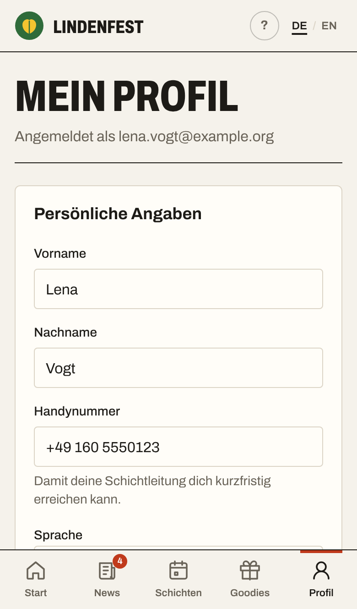

:::tip[Auf einen Blick]

- **Registrieren:** _Jetzt als Helfer\*in anmelden_ → Angaben ausfüllen → _Konto erstellen_ →
  Link in der E-Mail öffnen.
- **Keine Mail da?** Spam-Ordner prüfen, anmelden, _E-Mail erneut senden_ tippen.
- **Passwort vergessen?** Bei der Anmeldung _Passwort vergessen?_ tippen.
- **Daten ändern:** _Profil_ → _Persönliche Angaben_.

:::

## Registrieren

1. Öffne die Seite deines Festivals und tippe auf _Jetzt als Helfer\*in anmelden_. Auf der
   Anmeldeseite geht es auch über _Noch kein Konto?_ → _Registrieren_.
2. Füll _Vorname_, _Nachname_, _E-Mail-Adresse_, _Handynummer_ und _Passwort_ aus. Das Passwort
   braucht mindestens 10 Zeichen. Manche Festivals fragen hier noch ein paar weitere Dinge ab.
3. Tippe auf _Konto erstellen_. Es erscheint _Fast geschafft!_.
4. Öffne die E-Mail „Bitte bestätige deine E-Mail-Adresse“ und tippe auf den Link darin. Der Link
   ist 48 Stunden gültig und funktioniert auch auf einem anderen Gerät.
5. Es erscheint _Deine E-Mail-Adresse ist bestätigt. Willkommen!_ Tippe auf _Anmelden_ und melde
   dich mit E-Mail-Adresse und Passwort an. Bist du über einen Einladungslink gekommen, landest du
   danach direkt dort.

Steht dort _Die Registrierung ist gerade geschlossen_, nimmt das Festival gerade keine neuen
Helfenden an. Schau später wieder vorbei oder frag die Orga.

## Keine Bestätigungsmail

Ohne bestätigte Adresse kannst du dich zwar anmelden, siehst aber nur den Hinweis _Bitte bestätige
deine E-Mail-Adresse_. So kommst du weiter:

1. **Spam-Ordner prüfen.** Die Mail kommt manchmal erst nach ein paar Minuten.
2. **Neu senden:** Melde dich an und tippe auf _E-Mail erneut senden_. Nur der Link aus der
   neuesten Mail gilt, ältere Links funktionieren dann nicht mehr.
3. **Adresse prüfen:** Der Hinweis zeigt, an welche Adresse die Mail ging. Hast du dich vertippt,
   registriere dich mit der richtigen Adresse neu oder bitte die Orga, die Adresse zu korrigieren.
4. **Orga fragen:** Kommt gar nichts an, schreib über _Kontakt_ unten in der App. Die Orga kann
   deine Adresse von Hand als bestätigt markieren.

Steht nach dem Tippen auf den Link _Dieser Bestätigungslink ist ungültig oder abgelaufen_, ist er
älter als 48 Stunden oder es gibt schon einen neueren. Melde dich an und lass dir eine neue Mail
schicken.

## Anmelden

_Anmelden_ → E-Mail-Adresse und Passwort → _Anmelden_. Du bleibst auf dem Gerät angemeldet, bis du
dich abmeldest. _Abmelden_ findest du am Handy ganz unten im _Profil_, am Computer oben rechts.

Nach mehreren falschen Versuchen erscheint _Zu viele Versuche. Bitte warte ein paar Minuten._ Warte
kurz und versuche es dann noch einmal – oder setze dein Passwort zurück.

## Passwort vergessen

1. Tippe bei der Anmeldung auf _Passwort vergessen?_.
2. Gib deine E-Mail-Adresse ein und tippe auf _Link senden_.
3. Öffne den Link in der Mail „Passwort zurücksetzen“. Er ist **eine Stunde** gültig.
4. Gib ein neues Passwort ein und tippe auf _Passwort speichern_. Danach meldest du dich mit dem
   neuen Passwort an.

Aus Sicherheitsgründen steht dort immer _Falls es ein Konto mit dieser Adresse gibt, ist jetzt
eine E-Mail mit einem Link unterwegs_ – auch wenn es die Adresse gar nicht gibt. Kommt nichts an,
prüfe den Spam-Ordner und die Schreibweise der Adresse.

Wenn du dein Passwort zurücksetzt, wirst du auf allen anderen Geräten abgemeldet.

## Profil

Unter _Profil_ findest du:

- **_Persönliche Angaben_:** _Vorname_, _Nachname_, _Handynummer_ und _Sprache_. Die Handynummer
  braucht die Schichtleitung, um dich kurzfristig zu erreichen.
- **_Weitere Angaben_:** Fragen, die dein Festival zusätzlich stellt (zum Beispiel zur
  Verpflegung). Erscheint auf der Startseite _Bitte ergänze noch deine Angaben im Profil_, fehlt
  hier noch etwas Pflichtiges.
- **_Passwort ändern_:** mit dem aktuellen Passwort. Deine anderen Geräte werden dabei abgemeldet.
- Außerdem: [_Qualifikationen verwalten_](/wichtel/helpers/qualifications/),
  [_Gruppe_](/wichtel/helpers/group/), [_Kalender-Abo_](/wichtel/helpers/calendar/) und
  [_Meine Daten_](/wichtel/helpers/privacy/).

Deine **E-Mail-Adresse** steht oben (_Angemeldet als …_). Du kannst sie nicht selbst ändern – bitte
die Orga darum. Deine alte Adresse bekommt dann einen Hinweis.

## Sprache und Dunkelmodus

- **Sprache:** Tippe oben auf **DE** oder **EN**, oder wähle sie im Profil unter _Sprache_. Die
  Einstellung gilt auch für deine E-Mails.
- **Hell oder dunkel:** Die App richtet sich automatisch nach der Einstellung deines Handys oder
  Computers. Einen eigenen Schalter gibt es nicht.

## Häufige Fragen

### Muss ich mich jedes Jahr neu registrieren?

Nein. Dein Konto bleibt bestehen und gilt auch fürs nächste Festivaljahr. Punkte, Goodies und
Gruppen gelten aber immer nur für ein Festivaljahr.

### Ich habe mich mit einer Adresse registriert, die schon ein Konto hat.

Dann bekommst du statt der Bestätigung eine Mail „Du hast schon ein Konto“ mit einem Link, um ein
neues Passwort festzulegen.

## Sonderfälle

Die Orga hat mir einen Link zum Zurücksetzen geschickt

Kommt die Mail zum Zurücksetzen nicht an, kann die Orga dir einen Link erzeugen und dir persönlich
geben oder an deine Adresse schicken. Auch dieser Link gilt eine Stunde. Wer über so einen Link ein
neues Passwort festlegt, hat damit auch seine E-Mail-Adresse bestätigt.

Ich bekomme gar keine E-Mails, auch keine Bestätigung

Manche Festivals nutzen Wichtel ganz ohne E-Mail-Versand. Dann musst du deine Adresse nicht
bestätigen und kommst nach der Registrierung direkt in die App. _Passwort vergessen?_ funktioniert
dann aber nicht – wende dich in dem Fall an die Orga.

## Siehe auch

- [E-Mails von Wichtel](/wichtel/helpers/emails/)
- [Meine Daten und Konto löschen](/wichtel/helpers/privacy/)
- [Glossar](/wichtel/reference/glossary/)
