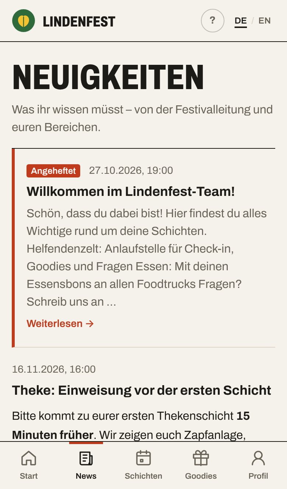

:::tip[Auf einen Blick]

- Unten auf _News_ tippen. Die Zahl am Menüpunkt zeigt, wie viele Beiträge neu sind.
- _Angeheftet_ steht oben, darunter das Neueste.
- Die neuesten Beiträge stehen auch auf der Startseite.
- Manche Beiträge kommen zusätzlich per E-Mail.

:::

## Wo finde ich die Neuigkeiten?

- **_News_** im Menü: alle Beiträge, die dich betreffen. Lange Beiträge öffnest du mit
  _Weiterlesen_.
- **Startseite:** die wichtigsten (angeheftet) und neuesten Beiträge, mit _Alle Neuigkeiten →_.

## Der Zähler

Die Zahl am Menüpunkt _News_ zählt die Beiträge, die erschienen sind, seit du die Neuigkeiten
zuletzt geöffnet hast. Sobald du _News_ öffnest, gilt alles als gelesen, und die Zahl verschwindet.

## Angeheftet

Wichtige Beiträge kann die Orga oben **anheften**. Sie stehen mit _Angeheftet_ immer zuerst –
manchmal nur bis zu einem bestimmten Datum. Darunter folgt das Neueste. Wurde ein Beitrag später
noch geändert, steht _aktualisiert …_ dabei.

## Von wem kommen die Beiträge?

Von der Festivalleitung und von den Leitungen der Bereiche. Du siehst einen Beitrag, wenn er dich
betrifft:

- Beiträge an **alle** (manche sind sogar öffentlich ohne Konto lesbar),
- Beiträge an **alle Helfenden** dieses Festivaljahrs – dafür brauchst du mindestens eine Schicht,
- Beiträge an einen **Bereich** oder eine **Schicht**, in der du eingetragen bist, angefragt hast
  oder einen reservierten Platz hast,
- Beiträge an die **Crew** oder eine bestimmte Rolle, wenn du eine hast.

Trägst du dich aus einer Schicht aus, verschwinden die Beiträge an diese Schicht und ihren Bereich
wieder aus deiner Liste. Wartelisten zählen dafür nicht.

Hat die Orga einen Beitrag auch auf Englisch geschrieben und du hast Englisch eingestellt, siehst
du die englische Fassung.

## Per E-Mail

Die Orga kann einen Beitrag zusätzlich per E-Mail an alle schicken, die er betrifft – sofern deine
E-Mail-Adresse bestätigt ist. Die Mail hat
den Titel des Beitrags als Betreff und einen Link zu den Neuigkeiten. Spätere Änderungen am Beitrag
werden nicht noch einmal verschickt – im Zweifel gilt, was in der App steht.

## Siehe auch

- [E-Mails von Wichtel](/wichtel/helpers/emails/)
- [Schnelle Hilfe](/wichtel/helpers/)
