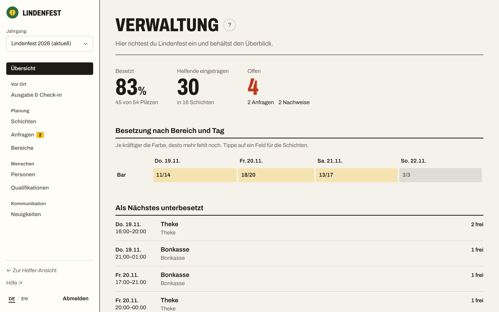

:::tip[Auf einen Blick]

- **Öffnen:** _Verwaltung_ → _Übersicht_ (die erste Seite nach dem Einstieg).
- **Besetzt** zeigt, wie viel Prozent der Plätze in deinen Bereichen vergeben sind.
- **Wo es fehlt:** in der Tabelle _Besetzung nach Bereich und Tag_ – je kräftiger die Farbe, desto
  mehr fehlt. Ein Feld antippen öffnet die Schichten.
- **Als Nächstes unterbesetzt** listet die nächsten Schichten mit freien Plätzen.
- Die Seite aktualisiert sich jede Minute von selbst.

:::

Die Zahlen beziehen sich immer auf den Jahrgang, der oben gewählt ist, und nur auf die Bereiche, in
denen deine Rolle _Besetzungs-Dashboard sehen_ oder Schichtrechte hat (_Schichten anlegen und
bearbeiten_, _Helfende ein- und austragen, Anfragen bestätigen_ oder _Anwesenheit bestätigen
(Check-in)_). Ohne eines dieser Rechte bleibt die Übersicht weitgehend leer.

Mit _Besetzungs-Dashboard sehen_ allein kannst du nur schauen: Die Zahlen sind dann keine Links, weil
du die Schichten selbst nicht öffnen darfst.

## Was du siehst

### Besetzt

Die große Prozentzahl: vergebene Plätze geteilt durch alle Plätze aller Schichten in deinen
Bereichen, darunter „45 von 54 Plätzen“. Gezählt werden Buchungen und für Gruppen
reservierte Plätze, keine offenen Anfragen.

### Helfende eingetragen

Wie viele verschiedene Personen in deinen Schichten eingetragen sind, darunter in wie vielen
Schichten.

### Offen

Erscheint nur, wenn etwas auf dich wartet:

- _2 Anfragen_ – Buchungsanfragen, Übergaben und Tausch. Der Link führt zu
  [_Anfragen_](/wichtel/leads/requests/).
- _2 Nachweise_ – Qualifikationsnachweise zum Prüfen, nur wenn du sie prüfen darfst. Der Link
  führt zu [_Qualifikationen_](/wichtel/leads/qualifications/).

### Heute

Alle Schichten deiner Bereiche, die heute beginnen, mit dem Stand der Anwesenheit: „3 von 4 da“
und gegebenenfalls „1 nicht erschienen“. Ein Klick öffnet die Schicht, dort hakst du ab (siehe
[Besetzung](/wichtel/leads/staffing/)).

### Besetzung nach Bereich und Tag

Eine Tabelle mit einer Zeile pro Bereich und einer Spalte pro Festivaltag. Jedes Feld zeigt „gebucht/
Plätze“ für alle Schichten dieses Bereichs, die an dem Tag beginnen.

- Je kräftiger die Farbe, desto mehr fehlt noch. Volle Felder sind grau.
- Ein Strich bedeutet: An dem Tag gibt es dort keine Schicht.
- Ein Feld antippen öffnet die Liste _Schichten_, gefiltert auf den Bereich und gesprungen zum Tag.

### Als Nächstes unterbesetzt

Die nächsten zehn Schichten, die noch nicht begonnen haben und freie Plätze haben, die früheste
zuerst – mit Tag, Uhrzeit, Bereich und „2 frei“. Läuft für eine Position ein
[Dringend-Aufruf](/wichtel/leads/urgent/), steht _Dringend_ dabei. Sind alle kommenden Schichten
voll, steht dort „Alle kommenden Schichten sind voll.“

## Häufige Fragen

### Muss ich die Seite neu laden?

Nein. Solange der Tab sichtbar ist, holt sich die Übersicht jede Minute die neuen Zahlen. Gut für
einen Bildschirm in der Helferzentrale.

### Warum zählen Anfragen nicht als besetzt?

Eine Anfrage ist noch keine Zusage. Erst wenn du sie bestätigst, wird daraus eine Buchung und der
Platz zählt.

### Warum sehe ich meinen Unterbereich als eigene Zeile, aber nicht den Bereich darüber?

Die Zeilen sind die obersten Bereiche, die du sehen darfst. Leitest du einen Unterbereich, erscheint
dieser als Zeile; leitest du einen ganzen Bereich, sind seine Unterbereiche darin zusammengefasst.

## Sonderfälle

Ich sehe auf der Übersicht „Erste Schritte“

Diese Liste ist eigentlich für die Einrichtung durch Admins gedacht. Leitungen mit dem Recht, Bereiche
anzulegen oder Personen zu sehen, bekommen die passenden Punkte daraus angezeigt, solange sie nicht
erledigt sind. Du kannst sie ignorieren.

Was ist mit Schichten, die schon vorbei sind?

_Besetzt_, _Helfende eingetragen_ und die Tabelle zählen alle Schichten des Jahrgangs, auch
vergangene. _Als Nächstes unterbesetzt_ zeigt nur Schichten, die noch nicht begonnen haben.

## Siehe auch

- [Schichten anlegen und bearbeiten](/wichtel/leads/shifts/)
- [Dringend aufrufen](/wichtel/leads/urgent/)
- [Dich in der Verwaltung zurechtfinden](/wichtel/leads/admin-area/)
