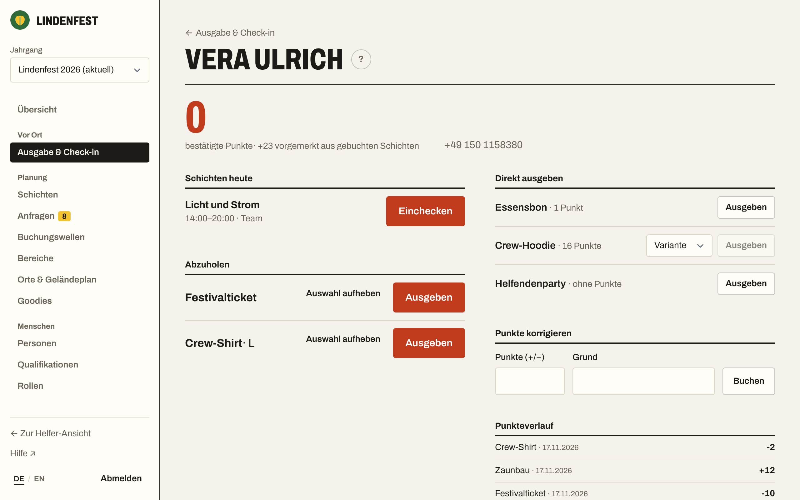

:::tip[Auf einen Blick]

- **Person öffnen:** ihren QR-Code mit der Kamera deines Handys scannen – oder _Ausgabe & Check-in_ →
  Namen suchen.
- **Einchecken:** unter _Schichten heute_ → _Einchecken_. Das geht ab 0:00 Uhr am Tag der Schicht.
- **Goodies:** unter _Abzuholen_ → _Ausgeben_.
- **Pflicht-Goodies** wie das Freiticket erscheinen von selbst unter _Abzuholen_, sobald die Punkte
  reichen.

:::

Den Menüpunkt _Ausgabe & Check-in_ siehst du, wenn deine Rolle _Goodies ausgeben_ oder _Anwesenheit
bestätigen (Check-in)_ hat oder _Punkte manuell anpassen_ für den ganzen Jahrgang. Was du auf der
Seite einer Person tun kannst, hängt davon ab, welches dieser Rechte du hast.

## Person öffnen

### Mit dem QR-Code

Jede helfende Person hat in der App unter _Punkte & Goodies_ einen persönlichen QR-Code.

1. Öffne die Kamera-App deines Handys und richte sie auf den Code.
2. Öffne den Link, den die Kamera erkennt. Du musst auf dem Handy in Wichtel angemeldet sein.
3. Du landest direkt auf der Ausgabe-Seite der Person.

Das klappt, wenn deine Rolle im aktuellen Jahrgang _Goodies ausgeben_ oder _Anwesenheit bestätigen
(Check-in)_ hat. Sonst meldet Wichtel „Dieser Code ist unbekannt.“

### Von Hand suchen

1. Öffne _Ausgabe & Check-in_.
2. Gib mindestens zwei Buchstaben des Namens unter _Person suchen_ ein und tippe auf _Suchen_. Nach
   der E-Mail-Adresse kannst du nur mit _Kontaktdaten der Helfenden sehen_ suchen.
3. Tippe die Person an.

Gefunden werden nur Personen, die in diesem Jahrgang dabei sind (mit einer Schicht, einem Goodie oder
Punkten), höchstens 20 Treffer.

## Die Seite einer Person

Oben stehen Name und _bestätigte Punkte_ (dazu „+3 vorgemerkt aus gebuchten Schichten“), mit
Kontaktrecht auch die Handynummer.

### Schichten heute

Alle Schichten der Person, die heute beginnen oder gerade laufen.

- _Einchecken_ setzt die Anwesenheit auf _da_. Die Punkte der Schicht werden sofort gutgeschrieben.
- Ist die Person schon _eingecheckt_, macht _Rückgängig_ das wieder auf _offen_ (die Punkte werden
  wieder abgezogen).

Einchecken kannst du nur Schichten in Bereichen, für die du _Anwesenheit bestätigen (Check-in)_ hast,
und ab 0:00 Uhr am Tag der Schicht – also auch morgens vor einer Abendschicht. _Nicht erschienen_
setzt du auf der Seite der Schicht (siehe [Besetzung](/wichtel/leads/staffing/)).

### Abzuholen

Goodies, die die Person ausgewählt hat oder die automatisch eingelöst wurden, mit Variante (z. B.
Größe) und den Angaben, die das Goodie braucht.

- _Ausgeben_ – du hast es übergeben.
- _Auswahl aufheben_ – die Auswahl wird storniert, die Person bekommt die Punkte zurück.
- Steht _Erstattung ausstehend_ dabei, hat die Person „Habe ich schon“ gewählt (z. B. sie hat schon
  ein Ticket). Dann tippst du auf _Als erstattet markieren_, sobald die Erstattung erledigt ist.

### Direkt ausgeben

Goodies, die die Person nicht vorher ausgewählt hat, kannst du hier sofort ausgeben – soweit sie
dafür in Frage kommt und die Punkte reichen.

### Punkte korrigieren

Nur mit _Punkte manuell anpassen_ für den ganzen Jahrgang: _Punkte (+/−)_ und einen _Grund_ eingeben,
dann _Buchen_. Der Grund steht im Punkteverlauf der Person und im Protokoll.

### Punkteverlauf

Die letzten Buchungen auf dem Punktekonto: Schichten, Goodies und Korrekturen.

## Pflicht-Goodies

Manche Goodies sind Pflicht-Goodies, z. B. das Freiticket. Sobald eine Person durch das Einchecken
genug bestätigte Punkte hat, wird das Pflicht-Goodie automatisch eingelöst und steht sofort unter
_Abzuholen_ – du kannst es direkt nach dem Einchecken ausgeben. Gibt es mehrere, werden sie in der
festgelegten Reihenfolge eingelöst.

## Häufige Fragen

### Der Knopf „Einchecken“ fehlt

Entweder hat die Schicht in einem Bereich, für den du keine Check-in-Rechte hast, oder sie beginnt
nicht heute.

### Die Person ist nicht zu finden

Hat sie in diesem Jahrgang noch keine Schicht, kein Goodie und keine Punkte, erscheint sie hier nicht.
Trag sie zuerst in eine Schicht ein (siehe [Besetzung](/wichtel/leads/staffing/)).

## Sonderfälle

Das Pflicht-Goodie erscheint nach einer Punktekorrektur nicht

Pflicht-Goodies werden nach dem Abhaken der Anwesenheit eingelöst, nicht nach einer manuellen
Punktekorrektur. Reichen die Punkte, kannst du das Goodie unter _Direkt ausgeben_ ausgeben.

Wird festgehalten, wer was ausgegeben hat?

Ja. Einchecken, Ausgeben, Stornieren, Erstatten und Punktekorrekturen stehen im Protokoll.

## Siehe auch

- [Besetzung](/wichtel/leads/staffing/)
- [Goodies einrichten (für Admins)](/wichtel/organizers/goodies/)
- [Vor Ort (Sicht der Helfenden)](/wichtel/helpers/on-site/)
