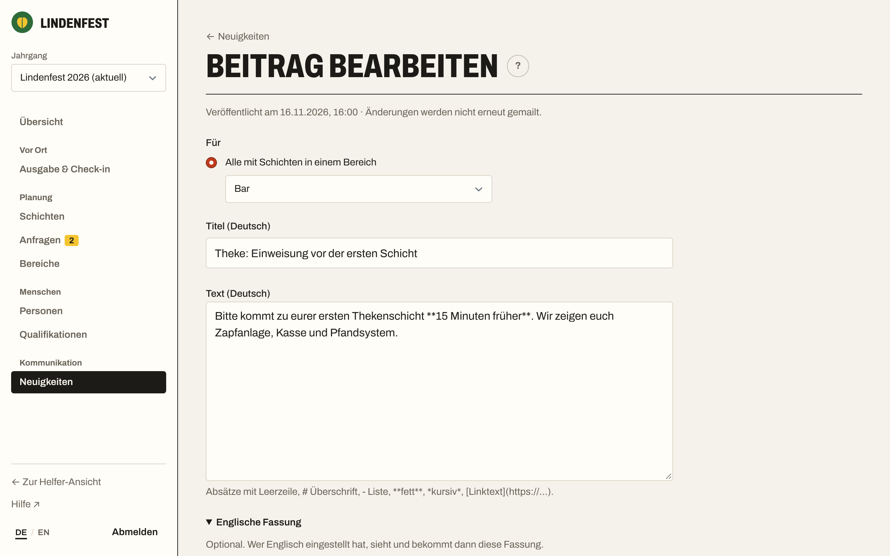

:::tip[Auf einen Blick]

- **Neu:** _Verwaltung_ → _Neuigkeiten_ → _Neuer Beitrag_ → _Für_ wählen → Titel und Text →
  _Vorschau_ → _Veröffentlichen_.
- **An eine Schicht:** Schicht öffnen → _Nachricht an alle_.
- **Per E-Mail:** _Auch per E-Mail senden_ ankreuzen – geht an alle, die der Beitrag jetzt betrifft.
- **Wichtiges oben halten:** _Oben anheften_, optional _Angeheftet bis einschließlich_.
- Dafür braucht deine Rolle _Neuigkeiten veröffentlichen (auch per E-Mail)_.

:::

Neuigkeiten erscheinen im Newsfeed der Helfenden (_News_ in der App, die neuesten auch auf der
Startseite) – aber nur bei denen, für die sie bestimmt sind.

## Für wen du schreiben kannst

| _Für_                                 | Wen das erreicht                                                                                    | Wer das wählen darf                                                                  |
| ------------------------------------- | --------------------------------------------------------------------------------------------------- | ------------------------------------------------------------------------------------ |
| _Alle in dieser Schicht_              | alle, die in der Schicht eingetragen sind, angefragt haben oder einen reservierten Platz haben      | nur über _Nachricht an alle_ auf der Seite der Schicht; Recht im Bereich der Schicht |
| _Alle mit Schichten in einem Bereich_ | alle mit einer Schicht in dem Bereich oder seinen Unterbereichen (auch Anfragen und Reservierungen) | für die Bereiche, in denen du das Recht hast                                         |
| _Alle Helfenden dieses Jahrgangs_     | alle mit mindestens einer Schicht im Jahrgang                                                       | Recht für den ganzen Jahrgang                                                        |
| _Alle mit einer Rolle (Crew)_         | alle mit einer Rolle im Jahrgang                                                                    | Recht für den ganzen Jahrgang                                                        |
| _Alle mit dieser Rolle_               | alle mit der gewählten Rolle im Jahrgang                                                            | Recht für den ganzen Jahrgang                                                        |
| _Alle Konten_                         | alle Konten                                                                                         | nur Admins                                                                           |
| _Öffentlich (auch ohne Konto)_        | alle, auch ohne Anmeldung                                                                           | nur Admins                                                                           |

Das Formular bietet dir nur an, was du wählen darfst, und wählt die engste Gruppe vor. Wer erst
später eine Schicht im Bereich bucht, sieht einen Bereichs-Beitrag dann auch.

## Schritt für Schritt

1. Öffne _Neuigkeiten_ und tippe auf _Neuer Beitrag_ – oder auf der Seite einer Schicht auf
   _Nachricht an alle_.
2. Wähle unter _Für_ die Gruppe, bei _Alle mit Schichten in einem Bereich_ auch den Bereich.
3. Schreib _Titel (Deutsch)_ und _Text (Deutsch)_. Der Text kann einfach formatiert werden: Absätze mit
   Leerzeile, `# Überschrift`, `- Liste`, `**fett**`, `*kursiv*`, `[Linktext](https://…)`.
4. Optional unter _Englische Fassung_: Titel und Text auf Englisch. Wer Englisch eingestellt hat, sieht
   und bekommt dann diese Fassung, sonst die deutsche.
5. Optional _Oben anheften_ und _Angeheftet bis einschließlich_ (siehe unten).
6. Optional _Auch per E-Mail senden_.
7. Tippe auf _Vorschau_. Du siehst „So sehen es die Helfenden“ und „Erreicht 37 Personen“.
8. Passt alles, tippe auf _Veröffentlichen_ und bestätige („Beitrag veröffentlichen und an 37
   Personen mailen?“, wenn die E-Mail mitgeht).

## Per E-Mail

Mit _Auch per E-Mail senden_ bekommen alle, die der Beitrag **im Moment des Veröffentlichens**
betrifft, ihn zusätzlich als E-Mail – in ihrer Sprache, mit einem Link zum Beitrag. Wer später dazukommt,
sieht ihn nur im Newsfeed. Konten, deren E-Mail-Adresse noch nicht bestätigt ist, bekommen keine
Mail (und zählen bei der Anzahl nicht mit). In der Liste steht danach „per E-Mail an 37“.

## Anheften

_Oben anheften_ hält den Beitrag über allen anderen, z. B. bei einer Störung. Mit _Angeheftet bis
einschließlich_ endet das am Ende des gewählten Tages von selbst; ohne Datum bleibt er angeheftet,
bis du es abschaltest. Angeheftete Beiträge sind in der Liste mit _Angeheftet_ markiert.

## Ändern und löschen

1. Tippe in der Liste _Neuigkeiten_ auf den Beitrag.
2. Ändere ihn unter _Beitrag bearbeiten_ und tippe auf _Speichern_ – oder tippe auf _Löschen_ und
   bestätige.

:::note
Änderungen werden nicht erneut gemailt. Gelöschte Beiträge verschwinden für alle aus dem Newsfeed;
eine schon verschickte E-Mail lässt sich nicht zurückholen.
:::

Du kannst alle Beiträge ändern und löschen, deren Gruppe du auch selbst wählen dürftest – also auch
die von Kolleg:innen in deinem Bereich. In der Liste steht bei jedem Beitrag, wer ihn geschrieben hat.

## Häufige Fragen

### Warum kann ich nicht „Alle Helfenden dieses Jahrgangs“ wählen?

Dafür braucht deine Rolle das Recht für den ganzen Jahrgang. Mit einer Rolle für einen Bereich
schreibst du an deinen Bereich und an einzelne Schichten darin.

### Wie erreiche ich nur eine Schicht?

Öffne die Schicht und tippe auf _Nachricht an alle_. Nur so lässt sich _Alle in dieser Schicht_
wählen.

## Sonderfälle

Was passiert mit einem Beitrag, wenn seine Schicht oder sein Bereich gelöscht wird?

Er erreicht dann niemanden mehr – lieber niemanden als alle. Ändern kann ihn danach nur noch ein
Admin.

## Siehe auch

- [Neuigkeiten lesen (Sicht der Helfenden)](/wichtel/helpers/news/)
- [E-Mails (für Admins)](/wichtel/organizers/mail/)
