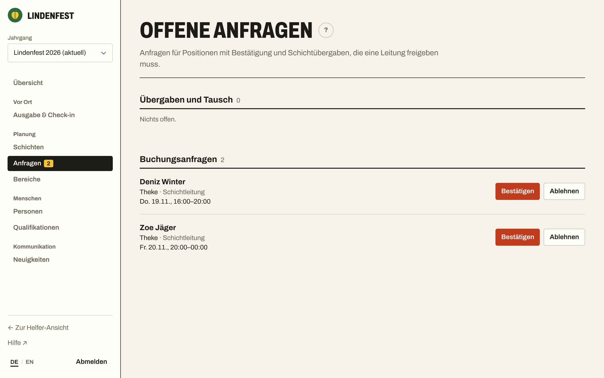

:::tip[Auf einen Blick]

- **Öffnen:** _Verwaltung_ → _Anfragen_. Die Zahl neben dem Menüpunkt zeigt, wie viel offen ist.
- **Oben** stehen _Übergaben und Tausch_, **darunter** _Buchungsanfragen_.
- Bei jedem Eintrag: _Bestätigen_ oder _Ablehnen_. Die Beteiligten bekommen eine E-Mail.
- Du siehst nur Anfragen aus Bereichen, in denen du _Helfende ein- und austragen, Anfragen
  bestätigen_ darfst.

:::

## Buchungsanfragen

Eine Buchungsanfrage entsteht, wenn sich jemand für eine Position _auf Anfrage_ meldet (siehe
[Positionen](/wichtel/leads/positions/)). Jeder Eintrag zeigt die Person, die Schicht, die Position
und die Zeit. Die Schicht ist ein Link zu ihrer Seite, der Name zur Personenseite – Letzteres nur,
wenn du _Personen_ öffnen darfst.

- **_Bestätigen_** – die Person ist eingetragen und bekommt die E-Mail „Bestätigt: …“. Ist die
  Position inzwischen voll, kommt „Alle Plätze sind schon vergeben.“ – dann erst Platz schaffen oder
  ablehnen.
- **_Ablehnen_** – die Person bekommt die E-Mail „Leider nicht geklappt: …“ mit einem Link zu anderen
  Schichten.

Dieselben Knöpfe findest du auch direkt in der Besetzungsliste der Schicht, neben dem Stand
_Anfrage_.

## Übergaben und Tausch

Helfende können ihre Schicht an jemand anderen abgeben oder mit jemandem tauschen. Meist läuft das
ohne dich. Eine Leitung muss nur bestätigen, wenn

- die Position _auf Anfrage_ ist (dann immer), oder
- die Frist zum Austragen schon vorbei ist und dein Festival oder dein Bereich eingestellt hat, dass
  späte Übergaben bestätigt werden müssen.

Ein Eintrag zeigt die Schicht, die Position, die Zeit und wer an wen abgibt:

- „Anna → Ben“ – Anna gibt ihre Schicht an Ben ab.
- „Anna ↔ Ben, im Tausch gegen …“ – die beiden tauschen; dahinter steht Bens Schicht.

Bis du entscheidest, bleibt alles, wie es ist: Die abgebende Person bleibt eingetragen.

- **_Bestätigen_** – Wichtel prüft noch einmal, dass die Schicht nicht begonnen hat und die
  übernehmende Person die nötigen Qualifikationen und zu der Zeit keine andere Schicht hat. Dann wird
  die Schicht umgebucht. Wer übernimmt, bekommt „Du bist eingetragen: …“, wer abgibt „Übernommen: …“.
- **_Ablehnen_** – beide bekommen „Übergabe nicht zustande gekommen: …“. An ihren Schichten ändert
  sich nichts.

## Häufige Fragen

### Warum sehe ich eine Anfrage nicht, die eine Kollegin sieht?

Du siehst nur Anfragen aus deinen Bereichen. Bei einem Tausch musst du für **beide** Schichten
zuständig sein – liegen sie in verschiedenen Bereichen, entscheidet jemand, der für beide Rechte hat
(z. B. eine Leitung für den ganzen Jahrgang).

### Kann ich eine Entscheidung zurücknehmen?

Nicht auf dieser Seite. Hast du versehentlich bestätigt, trägst du die Person in der Schicht wieder
aus (siehe [Besetzung](/wichtel/leads/staffing/)). Hast du versehentlich abgelehnt, trägst du sie
selbst ein.

## Sonderfälle

Bestätigen klappt nicht, es kommt eine Fehlermeldung

Mögliche Gründe: Die Schicht hat schon begonnen, die abgebende Person wurde schon abgehakt, der
übernehmenden Person fehlt eine Qualifikation, oder sie hat inzwischen zur selben Zeit eine andere
Schicht. Dann kannst du die Übergabe nur ablehnen.

Ist das irgendwo dokumentiert?

Ja. Bestätigen, Ablehnen, Übergaben und Tausch stehen im Protokoll.

## Siehe auch

- [Positionen](/wichtel/leads/positions/)
- [Besetzung](/wichtel/leads/staffing/)
- [Schicht abgeben oder tauschen (Sicht der Helfenden)](/wichtel/helpers/cancel-swap/)
- [Buchungsregeln (für Admins)](/wichtel/organizers/booking-rules/)
