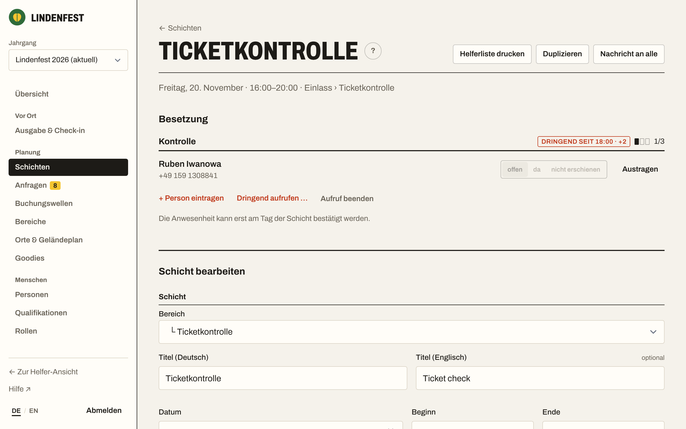

:::tip[Auf einen Blick]

- **Starten:** Schicht öffnen → bei der Position _Dringend aufrufen …_ → optional _Bonuspunkte_ und
  _Kurze Nachricht (optional)_ → _Aufruf senden_.
- **Wer die E-Mail bekommt:** alle mit bestätigtem Konto, die passen und zu der Zeit frei sind.
- **Bonuspunkte** bekommt, wer sich einträgt, solange der Aufruf läuft.
- **Beenden:** bei der Position _Aufruf beenden_. Ist die Position voll, endet der Aufruf von
  selbst.
- Höchstens einmal pro Stunde je Position – auch wenn du den Aufruf vorher beendest.

:::

## Schritt für Schritt

1. Öffne die Schicht (z. B. aus _Als Nächstes unterbesetzt_ auf der [Übersicht](/wichtel/leads/dashboard/)).
2. Tippe bei der Position, für die Leute fehlen, auf _Dringend aufrufen …_. Der Link erscheint nur,
   solange die Schicht noch nicht begonnen hat und Plätze frei sind.
3. Optional:
   - _Bonuspunkte_ (0 bis 100) – „Für alle, die sich jetzt eintragen. 0 = kein Bonus.“
   - _Kurze Nachricht (optional)_ – bis 300 Zeichen, steht in der E-Mail.
4. Tippe auf _Aufruf senden_. Du siehst „Aufruf an 23 Personen gesendet.“
5. Bei der Position steht jetzt „Dringend seit 14:05“ (mit „+2“, falls du Bonuspunkte
   vergeben hast).

## Wer die E-Mail bekommt

Alle Konten mit bestätigter E-Mail-Adresse, die

- noch nicht in dieser Schicht stehen (auch nicht auf der Warteliste),
- zu der Zeit keine andere Schicht haben (einschließlich der vorgeschriebenen Pause),
- alle Qualifikationen haben, die die Position als _Pflicht_ verlangt,
- bei einer internen Schicht eine Rolle haben, die den Bereich abdeckt.

Die E-Mail nennt Schicht, Position, die Zahl der freien Plätze, Zeit, Ort, deine Nachricht, den
Bonus und enthält einen Direktlink zur Schicht. Sie geht in der Sprache der jeweiligen Person raus.

## Was Helfende sehen

Solange der Aufruf läuft und Plätze frei sind, ist die Position in der Schichtliste als _Dringend_
markiert, mit „+2 Bonuspunkte“. Auf ihrer Startseite erscheint die Schicht unter _Dringend
gesucht_. Für eine Position mit laufendem Aufruf können sich alle eintragen, auch wenn ihre
Buchungswelle noch nicht offen ist.

## Bonuspunkte

Wer sich für die Position einträgt, solange der Aufruf läuft, bekommt die Bonuspunkte zusätzlich zu
den normalen Punkten. Gutgeschrieben werden sie – wie alle Schichtpunkte – erst, wenn die Person als
_da_ abgehakt ist (siehe [Besetzung](/wichtel/leads/staffing/)).

## Aufruf beenden

Tippe bei der Position auf _Aufruf beenden_. Ab dann bekommt niemand mehr die Bonuspunkte; wer sich
schon eingetragen hat, behält sie.

Ist die Position voll, endet der Aufruf von selbst. Wird danach wieder ein Platz frei, gibt es
keinen Bonus mehr – dafür musst du neu aufrufen.

## Häufige Fragen

### „Für diese Position wurde gerade erst aufgerufen. Bitte warte eine Stunde.“

Damit niemand mit E-Mails überschüttet wird, geht pro Position höchstens ein Aufruf pro Stunde raus.
Die Stunde zählt ab dem letzten Aufruf – auch wenn er inzwischen beendet ist.

### Kann ich den Bonus nachträglich ändern?

Nach einer Stunde kannst du erneut aufrufen und dabei einen neuen Bonus festlegen. Das verschickt
aber auch die E-Mail noch einmal.

### Wer darf dringend aufrufen?

Wer im Bereich der Schicht _Helfende ein- und austragen, Anfragen bestätigen_ darf.

## Sonderfälle

Bekommen auch Leute die E-Mail, die dieses Jahr noch gar nicht dabei sind?

Ja. Gesucht wird unter allen Konten mit bestätigter Adresse, nicht nur unter denen, die in diesem
Jahrgang schon eine Schicht haben.

Steht der Aufruf im Protokoll?

Ja, mit Bonus und Zahl der Empfänger:innen. Auch das Beenden wird protokolliert – endet der Aufruf
von selbst, weil die Position voll ist, ohne Person.

## Siehe auch

- [Die Übersicht](/wichtel/leads/dashboard/)
- [Neuigkeiten schreiben](/wichtel/leads/news/)
- [Punkte-Regeln (für Admins)](/wichtel/organizers/points/)
