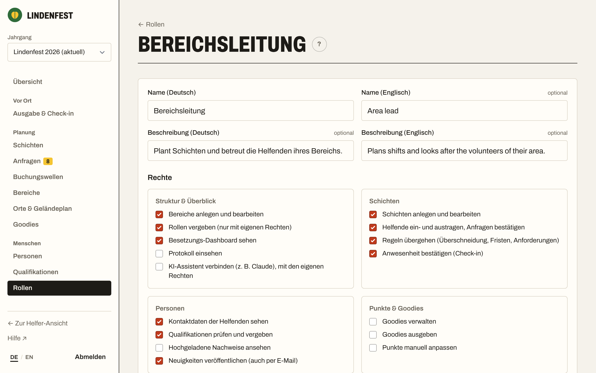

:::tip[Auf einen Blick]

- Eine **Rolle** bündelt Rechte, z. B. _Bereichsleitung_. Rollen legst du unter _Rollen_ an.
- **Vergeben:** _Personen_ → Person → _Rolle_ und _Gilt für_ wählen → _Rolle vergeben_.
- **Für einen Bereich** vergeben gilt die Rolle dort und in allen Unterbereichen; _Gesamten Jahrgang_
  gilt überall.
- Eine Vergabe gilt **nur für einen Jahrgang**.
- **Niemand kann mehr Rechte vergeben, als er selbst hat.** Admins dürfen alles.

:::

## Schritt für Schritt

### Eine Rolle anlegen oder ändern

1. Öffne _Rollen_ und tippe auf _Neue Rolle_ – oder auf eine bestehende Rolle.
2. Gib _Name (Deutsch)_ und _Name (Englisch)_ ein, gern mit kurzer Beschreibung.
3. Hake unter _Rechte_ an, was die Rolle darf (Erklärung unten).
4. Tippe auf _Anlegen_ bzw. _Speichern_.

Änderungen an einer Rolle wirken sofort für alle, die sie haben – in allen Jahrgängen. Nur Admins
legen Rollen an, ändern und löschen sie.

### Eine Rolle vergeben

1. Wähle oben im Schalter _Jahrgang_ den Jahrgang, für den die Rolle gelten soll.
2. Öffne _Personen_, such die Person und öffne sie. Sie braucht schon ein Konto.
3. Unter _Rollen im Jahrgang …_: _Rolle_ wählen, unter _Gilt für_ den Bereich oder _Gesamten Jahrgang_.
4. Tippe auf _Rolle vergeben_.

Zum Entziehen tippst du bei der Rolle auf _Entfernen_.

## Alle Rechte

### Struktur & Überblick

| Recht                                                            | Was es erlaubt                                                                                                                                                                                                                                                  |
| ---------------------------------------------------------------- | --------------------------------------------------------------------------------------------------------------------------------------------------------------------------------------------------------------------------------------------------------------- |
| _Bereiche anlegen und bearbeiten_                                | Unterbereiche anlegen, Bereiche bearbeiten, verschieben und löschen. Bereiche auf oberster Ebene nur mit Recht für den ganzen Jahrgang.                                                                                                                         |
| _Rollen vergeben (nur mit eigenen Rechten)_                      | Unter _Personen_ Rollen vergeben und entziehen – nur dort, wo man das Recht hat, und nur Rollen, deren Rechte man dort alle selbst hat.                                                                                                                         |
| _Besetzungs-Dashboard sehen_                                     | Auf der _Übersicht_ die Besetzung der eigenen Bereiche sehen (Zahlen, Tabelle nach Bereich und Tag, unterbesetzte Schichten) – nur lesend, ohne die Schichten öffnen zu können. Öffnet auch die Verwaltung. Wer Schichtrechte hat, sieht die Besetzung ohnehin. |
| _Protokoll einsehen_                                             | Das [Protokoll](/wichtel/organizers/audit/) des gewählten Jahrgangs lesen. Wirkt nur mit _Gesamten Jahrgang_.                                                                                                                                                   |
| _KI-Assistent verbinden (z. B. Claude), mit den eigenen Rechten_ | Einen [KI-Assistenten](/wichtel/organizers/ai/) verbinden. Zählt nur im aktuellen Jahrgang.                                                                                                                                                                     |

### Schichten

| Recht                                                       | Was es erlaubt                                                                                                                                 |
| ----------------------------------------------------------- | ---------------------------------------------------------------------------------------------------------------------------------------------- |
| _Schichten anlegen und bearbeiten_                          | Schichten und Serien planen. Mit _Gesamten Jahrgang_ zusätzlich _Buchungswellen_ und _Orte & Geländeplan_.                                     |
| _Helfende ein- und austragen, Anfragen bestätigen_          | Personen in Schichten eintragen und austragen, Anfragen und Übergaben entscheiden.                                                             |
| _Regeln übergehen (Überschneidung, Fristen, Anforderungen)_ | _Trotzdem eintragen_, auch wenn die Position voll ist, sich etwas überschneidet, die Schicht schon begonnen hat oder eine Qualifikation fehlt. |
| _Anwesenheit bestätigen (Check-in)_                         | In der Besetzung abhaken und unter _Ausgabe & Check-in_ einchecken.                                                                            |

### Personen

| Recht                                           | Was es erlaubt                                                                                                                                         |
| ----------------------------------------------- | ------------------------------------------------------------------------------------------------------------------------------------------------------ |
| _Kontaktdaten der Helfenden sehen_              | Telefonnummer und E-Mail-Adresse der Helfenden in den eigenen Bereichen sehen. Zählt nur im aktuellen Jahrgang.                                        |
| _Qualifikationen prüfen und vergeben_           | Nachweise bestätigen oder ablehnen, Qualifikationen vergeben und entziehen. Qualifikationen gelten für alle – das Recht in irgendeinem Bereich genügt. |
| _Hochgeladene Nachweise ansehen_                | Die hochgeladenen Dokumente öffnen. Zählt nur im aktuellen Jahrgang.                                                                                   |
| _Neuigkeiten veröffentlichen (auch per E-Mail)_ | Neuigkeiten für die eigenen Bereiche und deren Schichten schreiben; mit _Gesamten Jahrgang_ auch an weitere Gruppen.                                   |

### Punkte & Goodies

| Recht                     | Was es erlaubt                                                                                                          |
| ------------------------- | ----------------------------------------------------------------------------------------------------------------------- |
| _Goodies verwalten_       | Goodies anlegen und ändern. Wirkt nur mit _Gesamten Jahrgang_.                                                          |
| _Goodies ausgeben_        | Unter _Ausgabe & Check-in_ Goodies ausgeben.                                                                            |
| _Punkte manuell anpassen_ | Unter _Ausgabe & Check-in_ → _Punkte korrigieren_ Punkte gutschreiben oder abziehen. Wirkt nur mit _Gesamten Jahrgang_. |

Die Leitungs-Seiten erklären, wie man mit diesen Rechten arbeitet:
[Ich leite einen Bereich](/wichtel/leads/). Eine Übersicht aller Rechte steht auch unter
[Rechte](/wichtel/reference/permissions/).

## Typische Rollen

Bei der Einrichtung legt Wichtel diese Vorlagen an. Du kannst sie frei ändern. In Installationen, die
mit einer älteren Version eingerichtet wurden, fehlt der _Gesamtleitung_ noch _KI-Assistent
verbinden_ – ergänze es unter _Rollen_, wenn sie KI-Assistenten nutzen soll.

| Rolle             | Typisch vergeben für  | Rechte                                                                                                                                                |
| ----------------- | --------------------- | ----------------------------------------------------------------------------------------------------------------------------------------------------- |
| _Gesamtleitung_   | _Gesamten Jahrgang_   | alle, auch _KI-Assistent verbinden_                                                                                                                   |
| _Bereichsleitung_ | einen Bereich         | Bereiche, Rollen vergeben, Dashboard, Schichten, ein- und austragen, Regeln übergehen, Anwesenheit, Qualifikationen prüfen, Kontaktdaten, Neuigkeiten |
| _Schichtleitung_  | einen (Unter-)Bereich | Anwesenheit, Kontaktdaten, Dashboard                                                                                                                  |
| _Helferanmeldung_ | _Gesamten Jahrgang_   | Dashboard, ein- und austragen, Anwesenheit, Qualifikationen prüfen, Kontaktdaten, Goodies ausgeben                                                    |
| _Goodie-Ausgabe_  | _Gesamten Jahrgang_   | Goodies ausgeben                                                                                                                                      |

Beispiele:

- **Bar-Leitung:** _Bereichsleitung_ für „Bar“. Sie plant alle Schichten in „Bar“ und dessen
  Unterbereichen und kann dort selbst _Schichtleitung_ vergeben.
- **Infostand am Eingang:** _Helferanmeldung_ für den _Gesamten Jahrgang_, damit dort jede Schicht
  eingecheckt werden kann.
- **Merch-Stand:** _Goodie-Ausgabe_ für den _Gesamten Jahrgang_. Soll der Stand auch Punkte
  korrigieren, ergänze eine Rolle mit _Punkte manuell anpassen_ für den _Gesamten Jahrgang_.

## Häufige Fragen

### Was ist der Unterschied zwischen Admin und Rolle?

_Instanz-Admin_ ist eine Eigenschaft des Kontos, keine Rolle. Admins haben überall alle Rechte, in
jedem Jahrgang, und verwalten zusätzlich _Einstellungen_, _Jahrgänge_, _Rollen_, _Profilfelder_,
_E-Mail-Vorlagen_, _Zustellung_ und _Datenschutz & Impressum_. Das kann keine Rolle.
[Jemanden zum Admin machen](/wichtel/organizers/people/)

### Warum kann jemand eine Rolle nicht vergeben?

Wer nicht Admin ist, braucht _Rollen vergeben_ für diesen Bereich **und** jedes Recht der Rolle dort
selbst. Eine Bereichsleitung ohne _Goodies ausgeben_ kann also keine _Goodie-Ausgabe_ vergeben. Das
Gleiche gilt fürs Entziehen.

### Kann eine Person mehrere Rollen haben?

Ja, beliebig viele – auch in verschiedenen Bereichen. Ihre Rechte addieren sich.

### Was passiert, wenn ich eine Rolle lösche?

Alle Vergaben dieser Rolle verschwinden mit, in allen Jahrgängen. Die Rollenliste zeigt, wie oft eine
Rolle vergeben ist.

## Sonderfälle

Warum sieht eine Leitung im neuen Jahr nichts mehr?

Rollen gelten pro Jahrgang. Wurde der neue Jahrgang ohne _Rollenvergaben (Leitungen)_ kopiert, muss
die Rolle neu vergeben werden. Rollen in einem archivierten Jahrgang geben gar keine Rechte mehr.
[Jahrgänge](/wichtel/organizers/editions/)

Warum sieht jemand Telefonnummern im alten Jahrgang nicht?

Konten gelten für alle Jahrgänge. Damit eine alte Rolle keine aktuellen Daten öffnet, zählen
_Kontaktdaten der Helfenden sehen_ und _Hochgeladene Nachweise ansehen_ nur über Rollen im
**aktuellen** Jahrgang.

Welche Rechte wirken nur für den ganzen Jahrgang?

_Protokoll einsehen_, _Goodies verwalten_ und _Punkte manuell anpassen_ wirken nur mit _Gesamten
Jahrgang_. _Buchungswellen_ und _Orte & Geländeplan_ brauchen _Schichten anlegen und bearbeiten_ für
den _Gesamten Jahrgang_. Für einen Bereich vergeben bewirken sie dort nichts.

## Hintergrund

Jede Vergabe ist ein Dreiklang: **Person + Rolle + Geltungsbereich**, und das für einen Jahrgang.
Der Geltungsbereich ist ein Bereich samt allen Unterbereichen oder der ganze Jahrgang. Jede Vergabe
und jede Änderung an Rollen steht im [Protokoll](/wichtel/organizers/audit/).

## Siehe auch

- [Rechte im Überblick](/wichtel/reference/permissions/)
- [Bereiche](/wichtel/organizers/areas/)
- [Personen verwalten](/wichtel/organizers/people/)
